# Lumo

**A gamified habit tracker for your household. Self-hosted, no cloud, no tracking.**

Everyone in the household builds habits, earns coins for completing them, and spends those coins on wishes (a movie night, a pizza, new headphones). Parents can supervise their children's accounts, a shared pot funds household rewards, and everything runs on a single small container with a SQLite file.

<p align="center">
  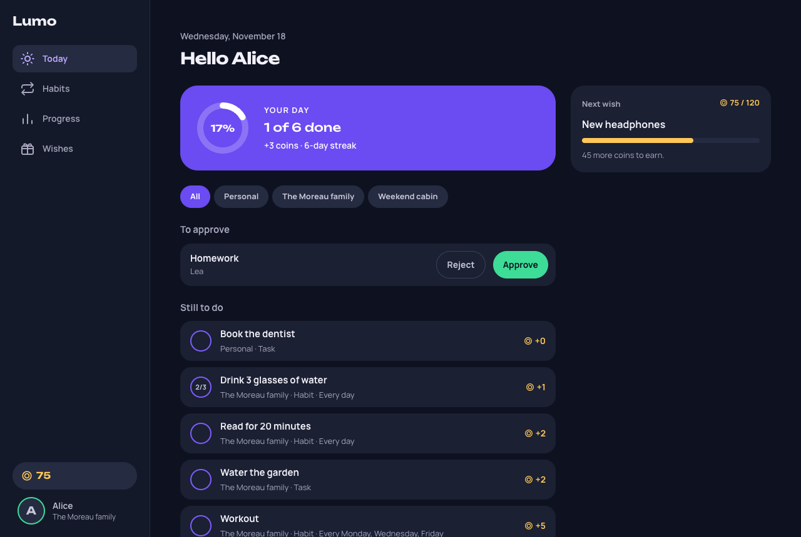
</p>

## Features

- **Habits** with flexible schedules, streaks, and coins earned on completion. Group them in spaces (personal, household, a weekend cabin…) and filter by space.
- **Wishes**: a catalogue of rewards you redeem with your coins, with progress towards the ones you cannot afford yet, weekly limits, and undo.
- **Progress**: completion rate per day and per week, streaks, coin history.
- **Households**: an account can belong to several households, each with its own members, roles (owner or member), shared habits, wishes and a coin **pot**. An account also works with no household at all, with a personal wallet.
- **Supervision**: a guardian can supervise a ward's account with a code, choose what the ward may do, and approve the items that require it.
- **Administration**: super admins manage accounts, households (archived, never deleted) and instance settings, and never see household content.
- **Single sign-on or local accounts**: OIDC (Authentik, Keycloak…) and/or local username and password.
- **Web and Android**, with an offline queue on mobile.
- **English and French**, following the browser or phone language.

The server is the only judge: coins, rights, schedules and streaks are computed on the server from a pure TypeScript domain, and every coin movement is an entry in an append-only ledger. Clients never send an amount.

## Screenshots

|                                        |                                                  |
| -------------------------------------- | ------------------------------------------------ |
| 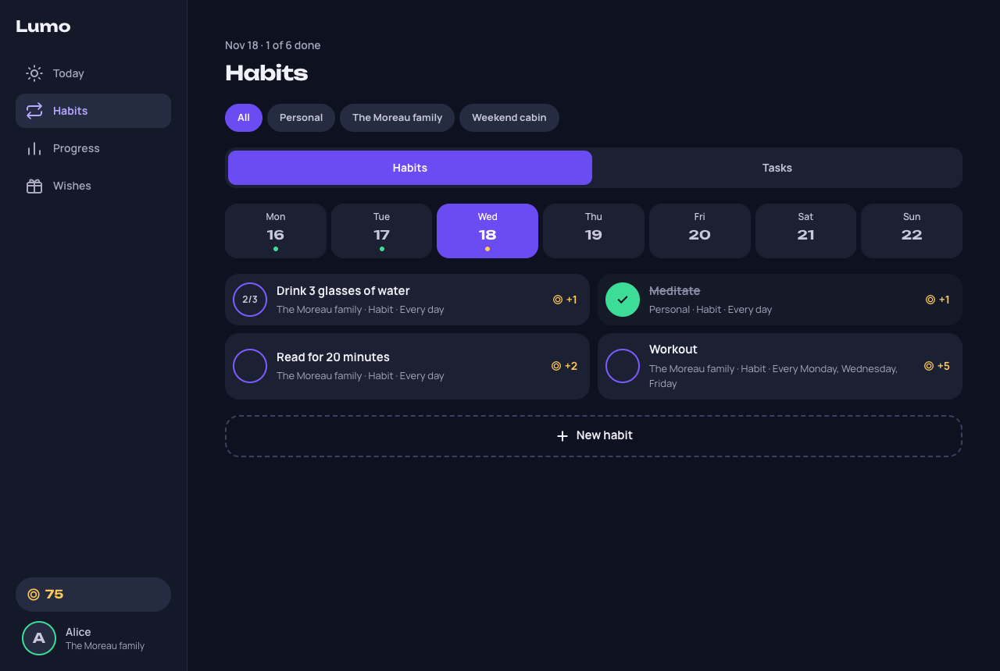 | 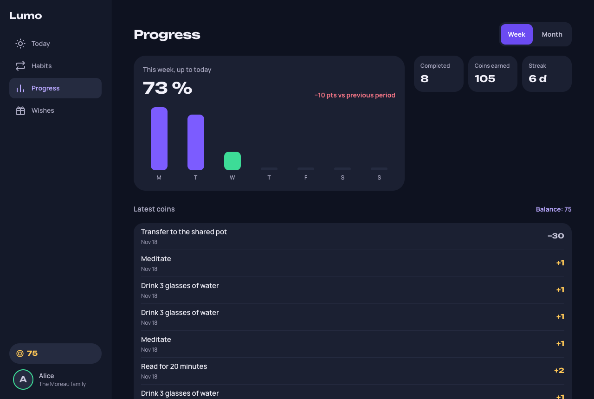       |
| **Habits**: schedules, spaces, rewards | **Progress**: weekly completion and streaks      |
| 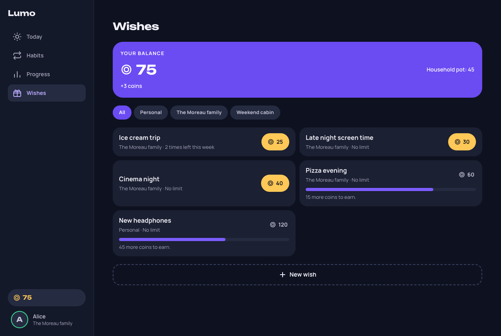 | 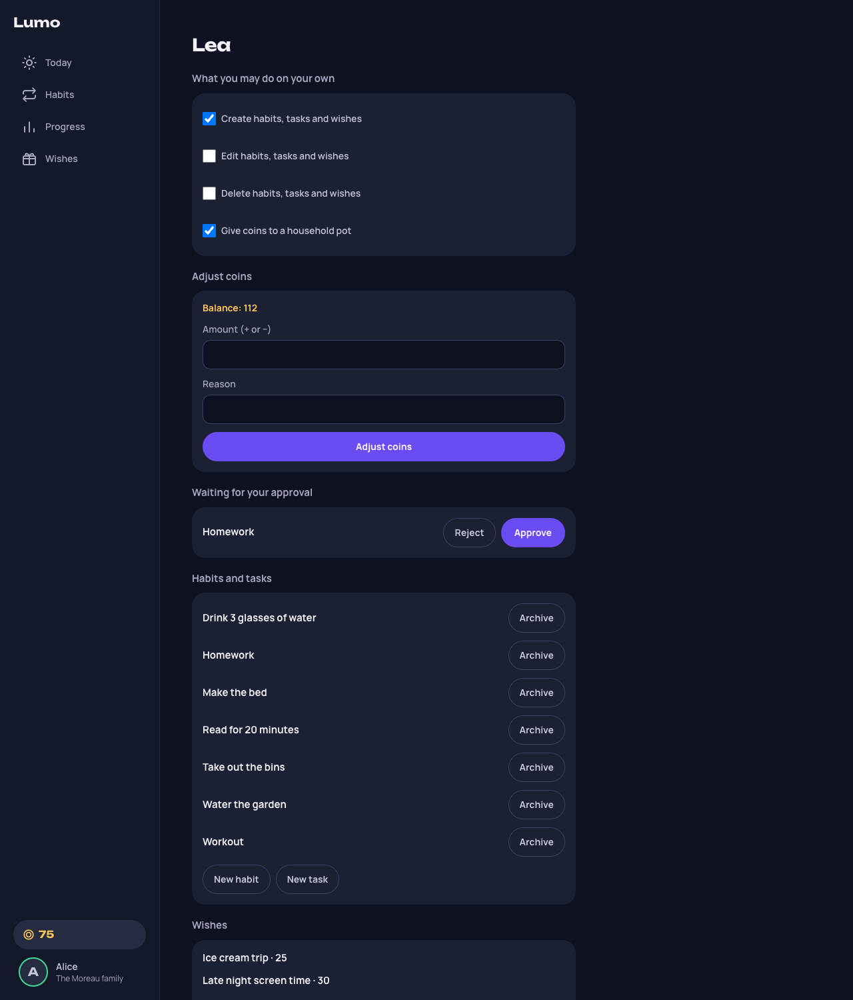 |
| **Wishes**: redeem or save up          | **Supervision**: what a ward may do, approvals   |

<details>
<summary>More screens</summary>

|                                              |                                          |
| -------------------------------------------- | ---------------------------------------- |
| 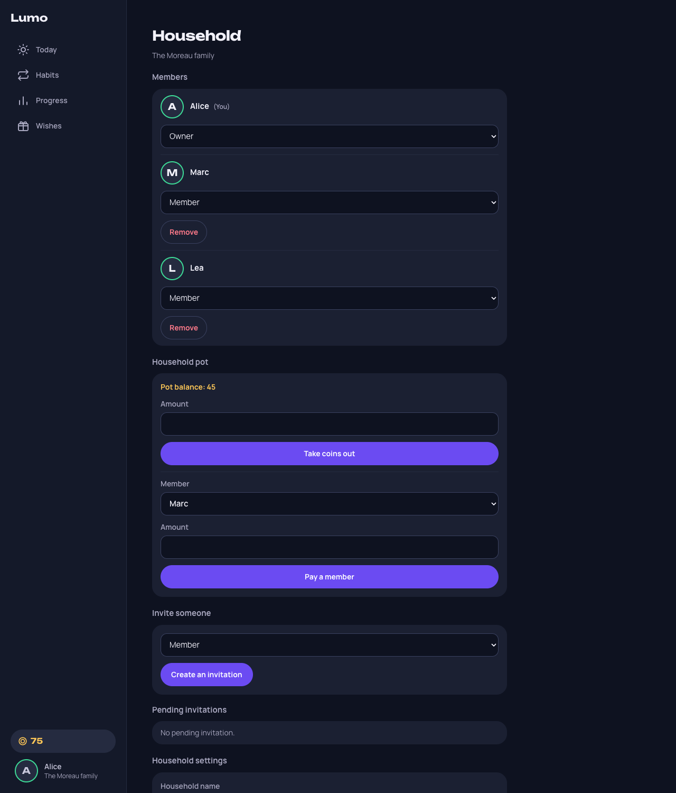 | 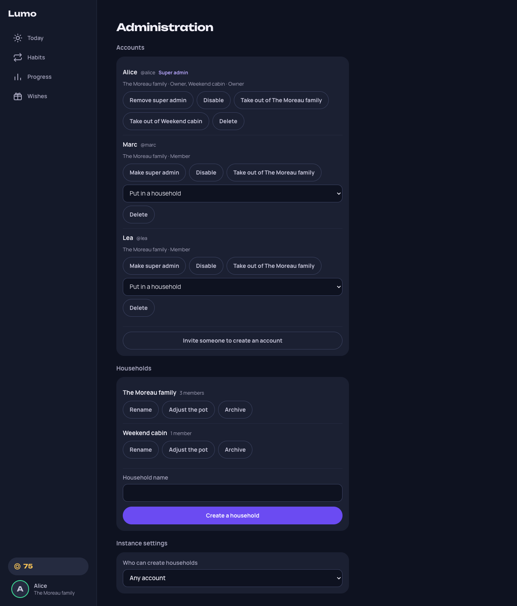     |
| **Household**: members, pot, invitations     | **Administration**: accounts, households |
| 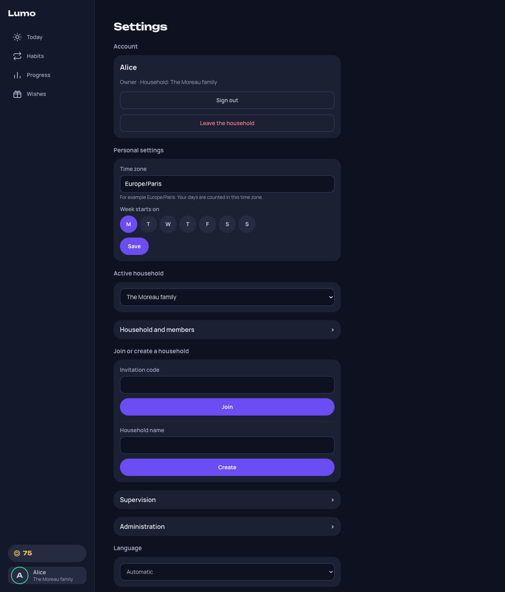   | 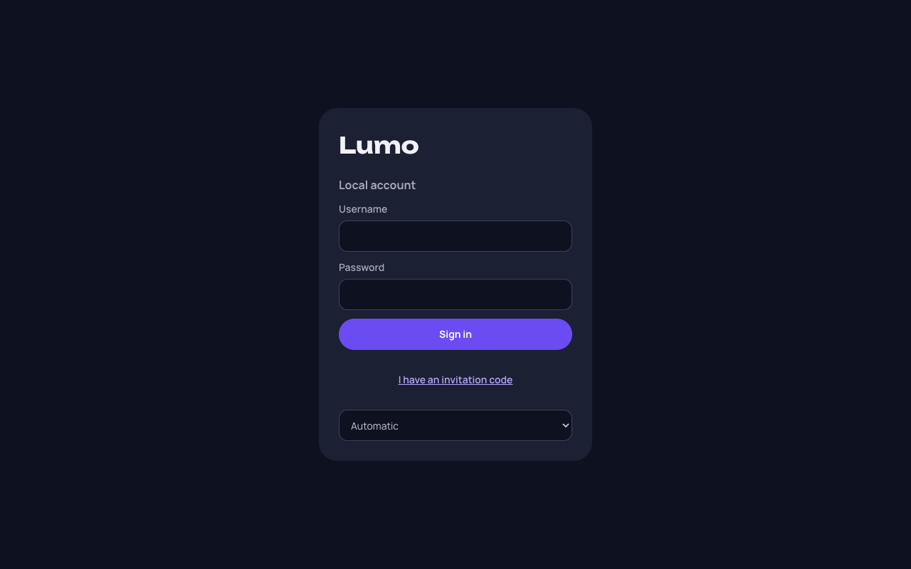   |
| **Settings**                                 | **Sign in**                              |

</details>

### On a phone

The mobile layout (shown here from the web app at phone width; the Android app uses the same design).

<p align="center">
  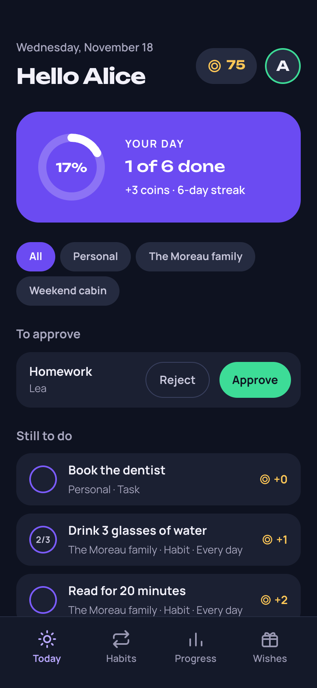
  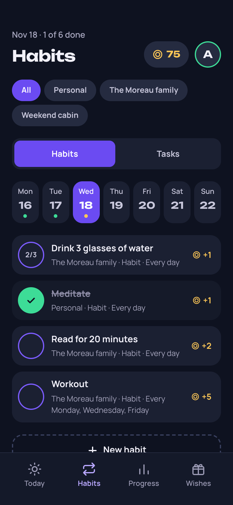
  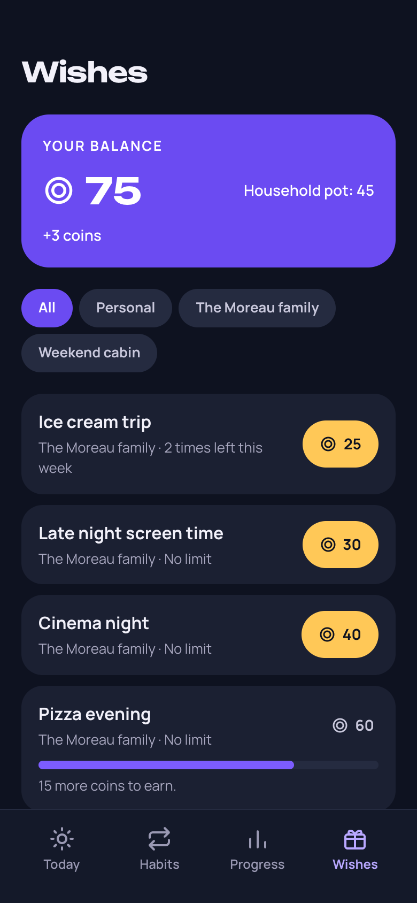
  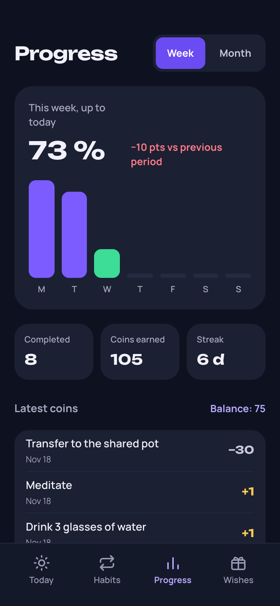
</p>

## Quick start (Docker)

```bash
cp .env.example .env   # fill in PUBLIC_URL and SESSION_SECRET (openssl rand -base64 48)
docker compose up -d   # app on :3000 + Litestream backup
```

Put it behind your reverse proxy with HTTPS, open `PUBLIC_URL`, and create the first account: it becomes a **super admin** and creates the first household.

The image is published by CI to `ghcr.io/<owner>/<repo>` (`edge` on every push to `main`, SemVer and `latest` on `vX.Y.Z` tags). Set `LUMO_IMAGE_OWNER` and `LUMO_VERSION` to choose it in `docker-compose.yml`. The data lives in the `/data` volume (SQLite, WAL: keep it on a local disk, never NFS or SMB). The `backup` service replicates it with [Litestream](https://litestream.io) when `LITESTREAM_*` is set.

### Configuration

| Variable                                                                             | Description                                                                                                    |
| ------------------------------------------------------------------------------------ | -------------------------------------------------------------------------------------------------------------- |
| `PUBLIC_URL`                                                                         | Public URL as seen by browsers. Required.                                                                      |
| `SESSION_SECRET`                                                                     | At least 32 random characters. Required.                                                                       |
| `DATABASE_PATH`                                                                      | SQLite file (`/data/lumo.db` in Docker).                                                                       |
| `LOCAL_AUTH_ENABLED`                                                                 | Local username and password accounts (default `true`).                                                         |
| `OIDC_ISSUER`, `OIDC_CLIENT_ID`, `OIDC_CLIENT_SECRET`                                | Enable OIDC sign-in (all three together, or none).                                                             |
| `OIDC_PROVIDER_NAME`                                                                 | Provider name shown on screen, e.g. `Authentik` (default `SSO`).                                               |
| `OIDC_ADMIN_GROUP`                                                                   | Members of this group become super admins when they sign in. Unset: nobody is promoted.                        |
| `OIDC_AUTO_CREATE_USERS`                                                             | `true` lets any user who can sign in create their own account on first sign-in. Default `false`: needs a code. |
| `LITESTREAM_REPLICA_URL`, `LITESTREAM_ACCESS_KEY_ID`, `LITESTREAM_SECRET_ACCESS_KEY` | Backup replication (optional).                                                                                 |

### Single sign-on

Create one OIDC application (confidential client) in your identity provider, with two redirect URIs: `PUBLIC_URL/api/v1/auth/callback` for the web and `lumo://auth` for mobile. Mobile never holds the secret: it gets the code through PKCE and the API exchanges it.

### How accounts are created

- The **first account** of an instance is always a super admin.
- Everyone else needs a **code**: a household invitation, a guardian code (to supervise a ward) or an administrator invitation. The code works with local sign-up or with single sign-on, so accounts can be created even when local auth is disabled.
- A local account can be **linked** to an identity from the settings ("Link with …").
- With `OIDC_AUTO_CREATE_USERS=true`, an unknown identity creates its own account (no household, not supervised) without a code.

## Development

Requirements: Node 22, pnpm (via Corepack).

```bash
pnpm install
cp .env.example apps/api/.env   # fill in SESSION_SECRET; PUBLIC_URL=http://localhost:5173
pnpm dev                        # API :3000 and web :5173 (the web app proxies /api)
```

```bash
pnpm lint        # Biome
pnpm typecheck
pnpm test        # Vitest (domain, i18n, mobile queue, API on a temporary SQLite file)
pnpm build
pnpm db:generate # new Drizzle migration after changing apps/api/src/db/schema.ts
pnpm --filter @lumo/api openapi:generate     # OpenAPI spec after a route change (checked by CI)
pnpm --filter @lumo/api-client generate      # typed client from the spec
```

Mobile: `cd apps/mobile && pnpm dev`. The app asks for the server address at first launch (a single APK serves every household); `EXPO_PUBLIC_API_URL` only pre-fills that field in development. CI builds the Android APK and attaches it to the GitHub release on tags.

### Repository layout

| Path                  | Content                                                  |
| --------------------- | -------------------------------------------------------- |
| `apps/api`            | Fastify API, Drizzle + SQLite, auth, ledger              |
| `apps/web`            | React, Vite, Tailwind web app                            |
| `apps/mobile`         | Expo (Android) app                                       |
| `packages/domain`     | Pure TypeScript rules: coins, rights, schedules, streaks |
| `packages/api-client` | Typed client generated from the OpenAPI spec             |
| `packages/i18n`       | Dictionaries (English source, French) and formatting     |
| `packages/tokens`     | Design tokens shared by web and mobile                   |

The full plan and every decision are in [docs/ARCHITECTURE.md](docs/ARCHITECTURE.md). The app is internationalised: English is the source language, and adding a language means adding one dictionary to `packages/i18n`.

## License

[AGPL-3.0-or-later](LICENSE)
